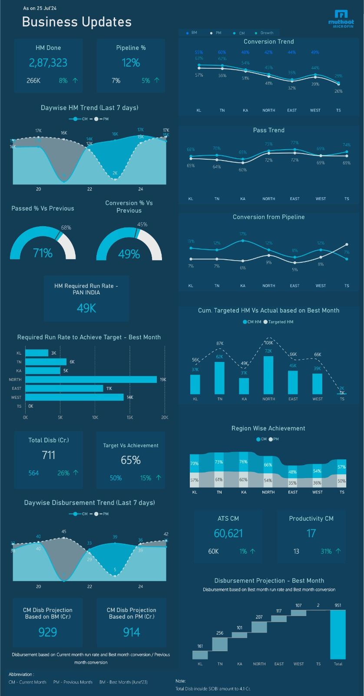
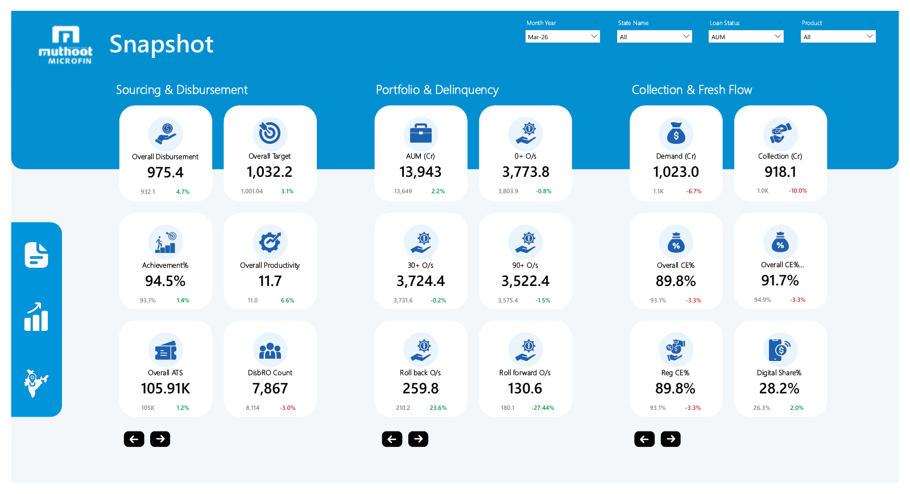
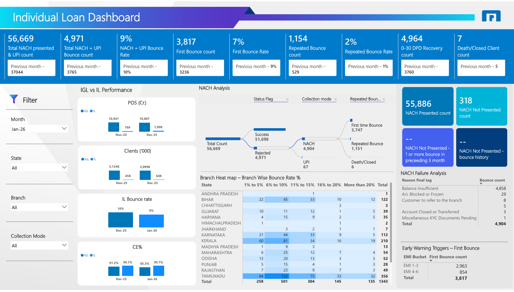

# Power BI Portfolio | Business Intelligence & Data Analytics

Data Analyst and BI Consultant with 5+ years of experience in data analytics, business intelligence, dashboard development and reporting. This portfolio presents Power BI dashboards built for a microfinance (NBFC-MFI) lender in India, each designed for a different decision-maker: field teams, senior management, and a loan-collections team.

## Executive Summary

Good dashboards answer a specific question for a specific audience. The three projects below show how I turn operational data into decision-ready reporting:

- **Field and manager monitoring:** daily credit-check, conversion and disbursement tracking against target and run rate.
- **Executive oversight:** a single KPI snapshot across sourcing, portfolio quality and collections, with trend and state-level drill-down.
- **Collections and risk analytics:** NACH/UPI bounce analysis by state, branch, failure reason and EMI bucket.

## Contents

- [Portfolio at a Glance](#portfolio-at-a-glance)
- [Business Performance Tracking](#business-performance-tracking)
- [Operational Performance](#operational-performance)
- [Loan Collections Analytics](#loan-collections-analytics)
- [What This Portfolio Demonstrates](#what-this-portfolio-demonstrates)
- [About the Assets](#about-the-assets)

## Portfolio at a Glance

| Project | Primary audience | Focus | Details |
|---|---|---|---|
| Business Updates Snapshot (V1, V2) | Field team, managers | Credit checks, conversion, disbursement vs target | [Project page](dashboards/business-performance-tracking/README.md) |
| Operational Performance Dashboard | Senior management (CEO, COO level) | Sourcing, portfolio quality, collections | [Project page](dashboards/operational-performance/README.md) |
| Individual Loan Dashboard | Director, individual loan team | NACH/UPI bounce and early-warning analysis | [Project page](dashboards/loan-collections-analytics/README.md) |

## Business Performance Tracking

### Business Updates Snapshot

**What it is:** a daily business-update report for field teams and managers, tracking credit checks, pass and conversion rates, disbursement, and progress against target.

**Business question (as described by the report owner):** where should the field team focus today to hit target, and where do managers need to intervene?

**Visible KPIs and dimensions:** credit checks done (HM), pipeline %, pass % and conversion % versus previous month, required run rate, total disbursement, target vs achievement, ATS, productivity, disbursement projection. Compared across current, previous and best month, and across regions.

**Power BI capabilities visible:** KPI cards with period-over-period change, gauges, 7-day trend charts, regional line charts, combo chart (actual vs target), ribbon chart, waterfall projection.

[Project page](dashboards/business-performance-tracking/README.md) | [Full-resolution V1](dashboards/business-performance-tracking/images/business-updates-snapshot-v1.png) | [Full-resolution V2](dashboards/business-performance-tracking/images/business-updates-snapshot-v2.jpg)

## Operational Performance

### Operational Performance Dashboard

**What it is:** a three-page executive report covering sourcing and disbursement, portfolio and delinquency, and collections, with trend and state-level views.

**Business question (as described by the report owner):** how is the organisation performing across every key KPI?

**Visible KPIs and dimensions:** disbursement, target, achievement %, productivity, AUM, 0+/30+/90+ outstanding, roll-back and roll-forward, demand, collection, collection efficiency, digital share. Filtered by month, state, loan status and product.

**Power BI capabilities visible:** grouped KPI cards with previous-period comparison, sparkline cards, tabbed trend charts, expandable region-to-state matrix, waterfall, portfolio movement (bucket transition) matrix, slicers, in-report navigation.

[Project page](dashboards/operational-performance/README.md) | [PDF export](dashboards/operational-performance/operational-performance-dashboard.pdf)

## Loan Collections Analytics

### Individual Loan Dashboard

**What it is:** a monthly report on individual-loan repayment behaviour, focused on NACH and UPI bounces.

**Business question (as described by the report owner):** how are individual loans performing this month, and where is the business lacking?

**Visible KPIs and dimensions:** NACH/UPI presented and bounce counts and rates, first and repeated bounce, 0-30 DPD recovery, IGL vs IL comparison (POS, clients, bounce rate, CE%), failure reasons, EMI bucket. Filtered by month, state, branch and collection mode.

**Power BI capabilities visible:** KPI strip with previous-month comparison, decomposition tree, conditional-format heat map matrix, comparison charts, slicers.

[Project page](dashboards/loan-collections-analytics/README.md) | [PDF export](dashboards/loan-collections-analytics/individual-loan-dashboard.pdf) | [Full-resolution image](dashboards/loan-collections-analytics/images/individual-loan-dashboard.png)

## What This Portfolio Demonstrates

- **Audience-specific design:** three different layouts for three different decision-makers, from a dense daily field view to an executive summary.
- **KPI design:** metrics shown with previous-period comparison, target, achievement and projection rather than as bare numbers.
- **Funnel and portfolio thinking:** credit check, pass, conversion and disbursement flow; delinquency buckets and bucket-to-bucket movement.
- **Analytical drill paths:** region to state hierarchy, decomposition of bounces by status and collection mode, branch heat map.
- **Usability:** slicers, tabbed metric switching and navigation elements, as visible in the screenshots.

## About the Assets

This repository contains **static screenshots and PDF exports** only. It does not include PBIX files, source data or live reports, and the dashboards are not available as interactive online versions. The figures shown belong to historical reporting periods and illustrate dashboard design. They are not performance claims.

See the [portfolio guide](docs/portfolio-guide.md) for the repository layout and terminology, and the [technical skills overview](docs/technical-skills.md) for what the dashboards evidence.

---

GitHub: [@vishalmini1-glitch](https://github.com/vishalmini1-glitch)
