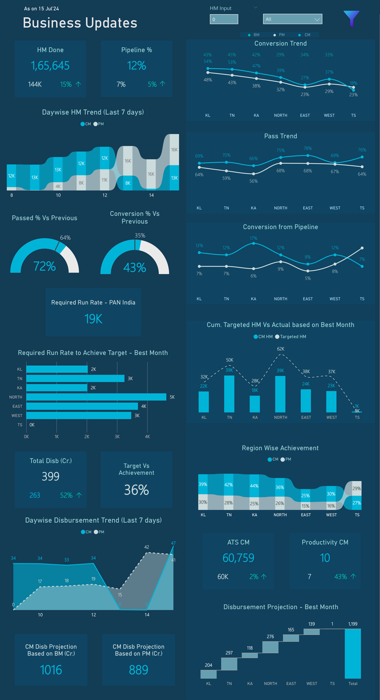
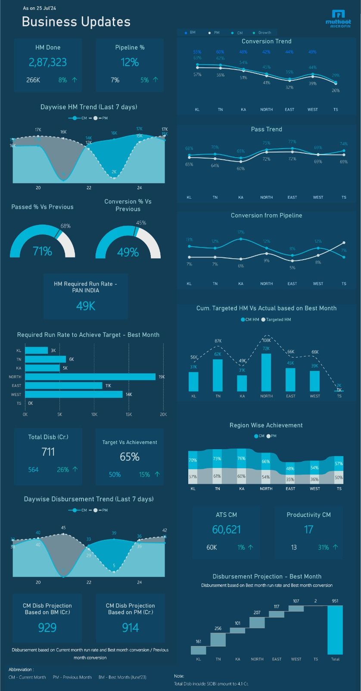

# Business Updates Snapshot | Daily Business Performance Tracking

[Back to portfolio](../../README.md)

Two versions of the report are included: **V1** (as on 15 Jul 2024) and **V2** (as on 25 Jul 2024).

## 1. Project Overview

A tall, single-page Power BI report that tracks the credit-check funnel and disbursement performance against target. It is aimed at field teams, who need to know what to focus on, and at managers, who use it to drive the business.

## 2. Business Problem

As described by the report owner: give the field team a clear daily view of credit checks and business performance so they can focus on target, and give managers a view they can use to drive results.

Assumption from the visuals: the report follows the funnel from credit checks (labelled HM) through pass rate and pipeline conversion to disbursement.

## 3. Business Objectives

- Track daily credit-check volume against the current, previous and best month.
- Show the run rate required to reach target, overall and by region.
- Monitor pass and conversion rates by region.
- Show disbursement against target and a projection for the month.

## 4. Key Performance Indicators

- HM Done and Pipeline %
- Passed % and Conversion % versus previous
- HM required run rate (PAN India) and by region
- Cumulative targeted HM versus actual (best-month basis)
- Total Disbursement (Cr.) and Target vs Achievement
- ATS and Productivity (current month)
- Disbursement projection based on best-month and previous-month run rate

Comparison basis, as defined in the report footnote: CM = current month, PM = previous month, BM = best month. Regional views use KL, TN, KA, North, East, West and TS.

## 5. Dashboard Features

Visible in the screenshots:

- KPI cards showing the current value, a comparison value and a percentage change with direction arrows.
- Last-7-days trend charts for credit checks and disbursement, current vs previous month.
- Gauge visuals for pass % and conversion % against the previous period.
- Regional line charts for conversion trend, pass trend and conversion from pipeline.
- Horizontal bar chart of required run rate by region.
- Combined column and line chart of targeted vs actual by region.
- Ribbon chart of region-wise achievement.
- Waterfall chart of disbursement projection by region.
- Footnotes defining abbreviations and basis of calculation.

Differences between versions: V1 shows an HM Input field, a dropdown set to "All" and a filter icon at the top. V2 adds an abbreviation key and a footnote on what total disbursement includes. How the V1 controls behave cannot be verified from a static image.

## 6. Technical Implementation

Built in Power BI. Data sources, data model, DAX measures, transformations and refresh process are not documented here because the PBIX file is not available.

## 7. Business Insights

A user of this report can see, for any region:

- whether credit-check volume is on pace against the required run rate;
- whether pass and conversion rates are improving or slipping against the previous month;
- which regions are ahead of or behind target;
- whether the month is projected to close above or below the best-month and previous-month benchmarks.

This page does not draw conclusions from the numbers shown in the screenshots.

## 8. Business Value

Potential value of this type of report: a shared daily view for field teams and managers, earlier visibility of regions falling behind target, and a consistent comparison basis (CM, PM, BM) across the organisation. These are intended uses, not measured results.

## 9. Tools and Technologies

- Power BI

## 10. Project Limitations

- Static images only; interactive behaviour (filters, cross-highlighting, drill) is not verifiable.
- No PBIX, source data or measure definitions are published.
- Figures are from July 2024 and illustrate the design.

## 11. Dashboard Preview

**V1 (15 Jul 2024)** and **V2 (25 Jul 2024)**

<table>
  <tr>
    <td width="50%"></td>
    <td width="50%"></td>
  </tr>
</table>

[Full-resolution V1](images/business-updates-snapshot-v1.png) | [Full-resolution V2](images/business-updates-snapshot-v2.jpg)
