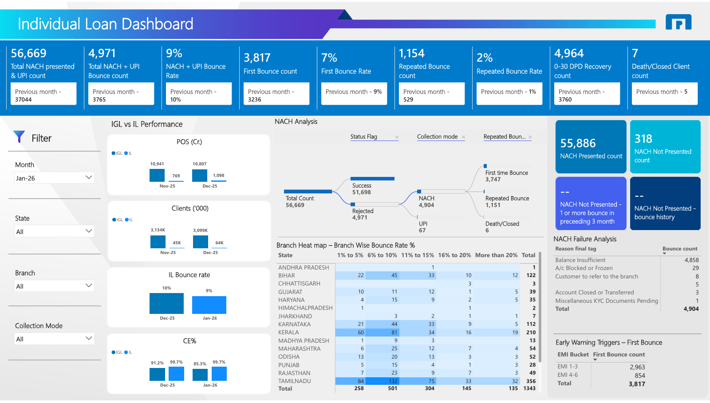

# Individual Loan Dashboard | NACH and UPI Bounce Analytics

[Back to portfolio](../../README.md)

## 1. Project Overview

A single-page Power BI report on the monthly performance of individual loans (IL), with a focus on NACH and UPI repayment bounces. It was built for the director and the individual loan team.

## 2. Business Problem

As described by the report owner: show how individual loans performed in the month and where the business is lacking, so the team can drive the business.

## 3. Business Objectives

- Track NACH and UPI presentation and bounce volumes against the previous month.
- Separate first-time bounces from repeated bounces.
- Find which states and branches have the highest bounce rates.
- Understand why bounces happen and at which EMI stage they first occur.
- Compare individual loans with IGL on portfolio and collection measures.

## 4. Key Performance Indicators

- Total NACH presented and UPI count
- Total NACH + UPI bounce count and bounce rate
- First bounce count and rate
- Repeated bounce count and rate
- 0-30 DPD recovery count
- Death/closed client count
- NACH presented and not-presented counts
- IGL vs IL: POS (Cr.), clients, IL bounce rate, CE %

Each headline KPI is shown with its previous-month value.

## 5. Dashboard Features

Visible in the screenshot:

- Slicers for Month, State, Branch and Collection Mode.
- KPI strip with previous-month comparison.
- Decomposition tree (NACH Analysis) splitting total count by status, collection mode and repeated-bounce flag.
- Branch heat map: state by bounce-rate band (1-5%, 6-10%, 11-15%, 16-20%, above 20%), with conditional colour shading.
- NACH failure analysis by reason tag.
- Early warning triggers: first-bounce count by EMI bucket.
- Comparison charts for IGL vs IL across two months.

## 6. Technical Implementation

Built in Power BI. Data sources, data model, DAX measures and refresh process are not documented here because the PBIX file is not available.

## 7. Business Insights

A user can see:

- whether bounce volume and rate are moving up or down against the previous month;
- how much of the bounce volume is new versus repeated;
- which states and branches sit in the higher bounce-rate bands;
- which failure reasons account for most bounces;
- whether first bounces cluster early in the loan (EMI 1-3 versus 4-6), which supports early-warning follow-up.

This page does not draw conclusions from the numbers in the screenshot.

## 8. Business Value

Potential value of this type of report: earlier identification of repayment stress, targeted branch-level follow-up and a shared view for the director and the loan team. These are intended uses, not measured results.

## 9. Tools and Technologies

- Power BI

## 10. Project Limitations

- Static PDF export; slicer and decomposition tree interactions are not verifiable.
- No PBIX, source data or measure definitions are published.
- Figures are for January 2026 and illustrate the design.
- Two of the NACH Not Presented cards show "--" in the export.

## 11. Dashboard Preview

[Full PDF export](individual-loan-dashboard.pdf) | [Full-resolution image](images/individual-loan-dashboard.png)
