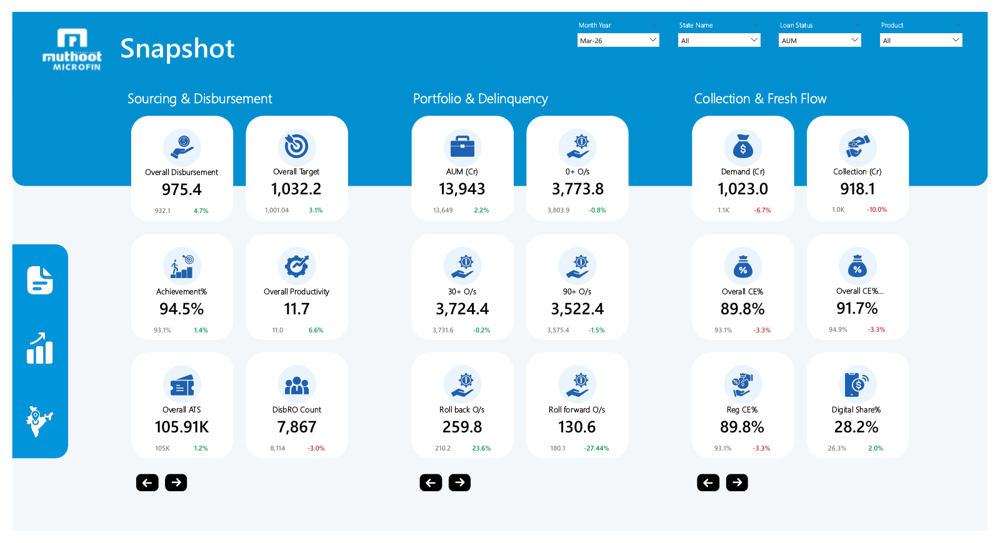
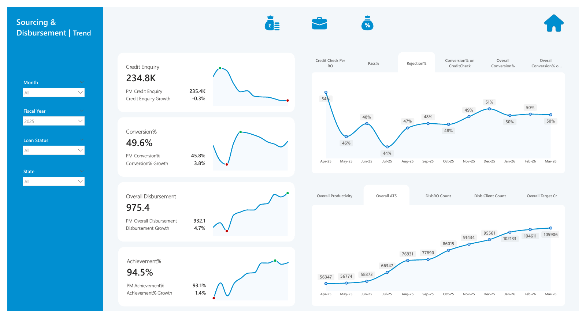
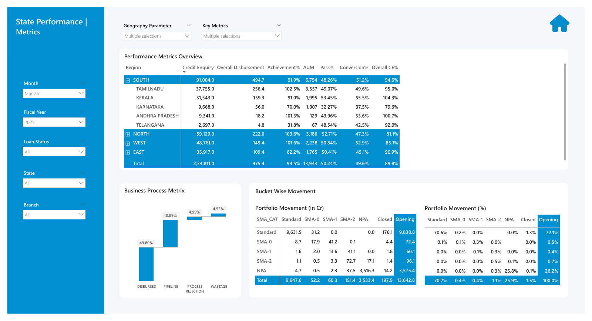

# Operational Performance Dashboard | Executive KPI Reporting

[Back to portfolio](../../README.md)

## 1. Project Overview

A three-page Power BI report for senior management (CEO and COO level). Page 1 is a KPI snapshot, page 2 shows sourcing and disbursement trends, and page 3 gives state-level metrics and portfolio movement.

## 2. Business Problem

As described by the report owner: give management a single place to see how the organisation is performing on every key KPI.

## 3. Business Objectives

- Present sourcing, portfolio and collection KPIs together, each with previous-period comparison.
- Show the trend of the sourcing and disbursement funnel over a fiscal year.
- Compare regions and states on the same metrics.
- Show how loan accounts moved between delinquency buckets.

## 4. Key Performance Indicators

**Sourcing and Disbursement:** Overall Disbursement, Overall Target, Achievement %, Overall Productivity, Overall ATS, DisbRO Count.

**Portfolio and Delinquency:** AUM, 0+ O/s, 30+ O/s, 90+ O/s, Roll back O/s, Roll forward O/s.

**Collection and Fresh Flow:** Demand, Collection, Overall CE %, Regular CE %, Digital Share %.

**Trend and funnel (pages 2 and 3):** Credit Enquiry, Conversion %, Pass %, Rejection %, Conversion on credit check, Credit check per RO, Disb Client Count, and the business process split of disbursed, pipeline, process rejection and wastage.

## 5. Dashboard Features

Visible in the screenshots:

- **Page 1, Snapshot:** slicers for Month Year, State Name, Loan Status and Product; grouped KPI cards with previous-period value and colour-coded change; left and right arrow buttons beneath each group; side navigation icons.
- **Page 2, Sourcing and Disbursement Trend:** slicers for Month, Fiscal Year, Loan Status and State; sparkline cards with high and low markers; two trend charts with tabs for switching the metric shown.
- **Page 3, State Performance Metrics:** Geography Parameter and Key Metrics multi-select controls; an expandable region-to-state table; a waterfall of the business process; a portfolio movement matrix by delinquency category (Standard, SMA-0, SMA-1, SMA-2, NPA, Closed), shown in Cr and in %.
- A home button on the detail pages.

How the tabs, arrow buttons and metric selectors are built cannot be determined from the exported pages.

## 6. Technical Implementation

Built in Power BI Desktop (shown on the exported pages). Data sources, data model, DAX measures and refresh process are not documented here because the PBIX file is not available.

## 7. Business Insights

A senior user can:

- compare achievement against target and against the previous period at a glance;
- see which regions and states are over- or under-performing on disbursement, conversion and collection efficiency;
- track portfolio quality through 0+, 30+ and 90+ outstanding and roll-forward versus roll-back movement;
- see how much of the portfolio moved between buckets during the month.

This page does not draw conclusions from the numbers in the screenshots.

## 8. Business Value

Potential value of this type of report: one consistent KPI view for leadership across sourcing, portfolio quality and collections, with fast drill-down from organisation to state. These are intended uses, not measured results.

## 9. Tools and Technologies

- Power BI Desktop

## 10. Project Limitations

- Static PDF export; interactions are not verifiable.
- No PBIX, source data or measure definitions are published.
- Figures are for March 2026 and illustrate the design.

## 11. Dashboard Preview

**Page 1: Snapshot**

**Page 2: Sourcing and Disbursement Trend**

**Page 3: State Performance Metrics**

[Full PDF export](operational-performance-dashboard.pdf)
